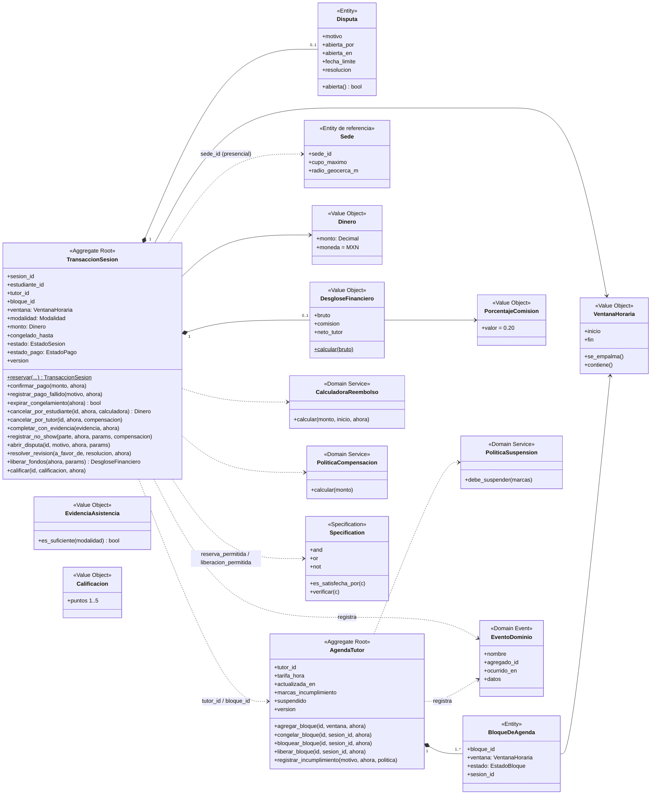

# Modelo de dominio DDD y diagrama de clases (implementación PIA)

Coincide con `src/domain/`. Composición (`*--`) = entidad interna de la raíz; las raíces se referencian solo por ID.



## Specifications implementadas (`src/domain/specifications.py`)

```text
reserva_permitida =  AnticipacionMinima(2 h)
                   AND PerfilVigente(7 días)
                   AND NOT TutorSuspendido
                   AND BloqueDisponible
                   AND (NOT EsPresencial OR CupoDisponible)

liberacion_permitida =  NOT DisputaAbierta
                      AND SesionCompletada
                      AND PagoConfirmado
                      AND RetencionCumplida(48 h)

paquete PIA:  PUEDE_PROCESARSE     = EstudianteActivo AND TieneLineas AND PagoAutorizado
              BENEFICIO_REFERENCIA = Preferente AND Total>=1500 AND NOT PromocionActiva
```

## Domain Events

`SesionReservada · PagoConfirmado · PagoRechazado · SesionConfirmada · CongelamientoExpirado · SesionCancelada ·
ReembolsoCalculado · SesionCompletada · SesionEnviadaARevision · NoShowRegistrado · DisputaAbierta · DisputaResuelta ·
FondosLiberados · SesionCalificada · HorarioCongelado · HorarioBloqueado · HorarioLiberado ·
MarcaIncumplimientoRegistrada · TutorSuspendido`
