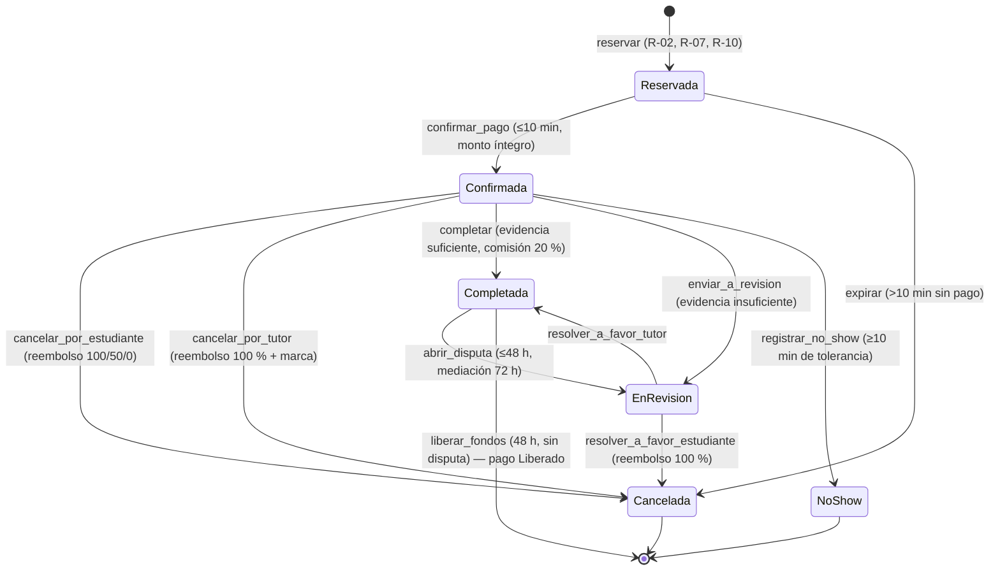
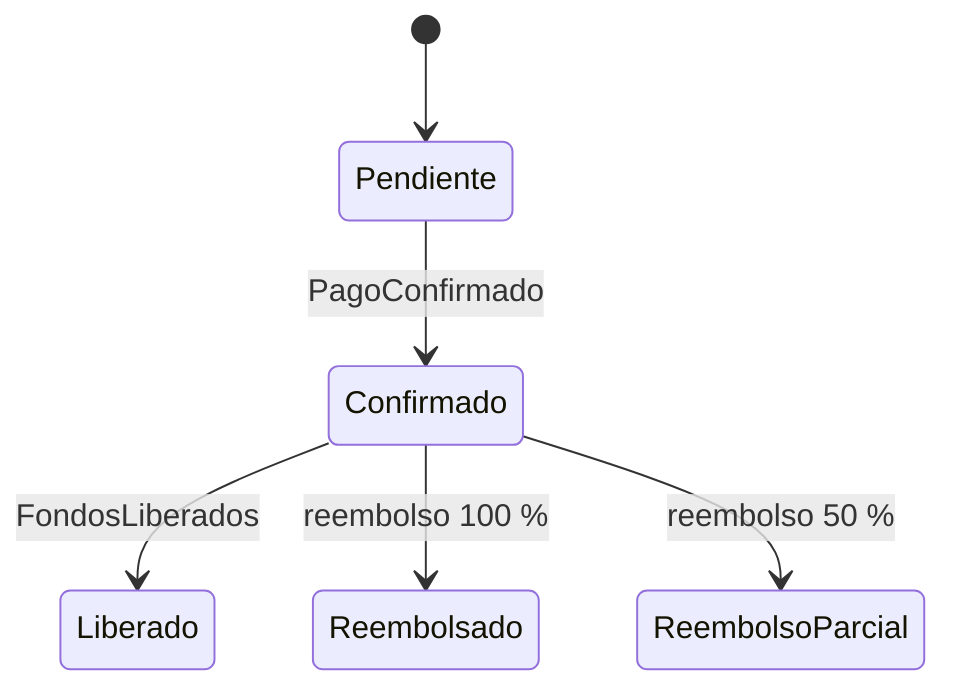
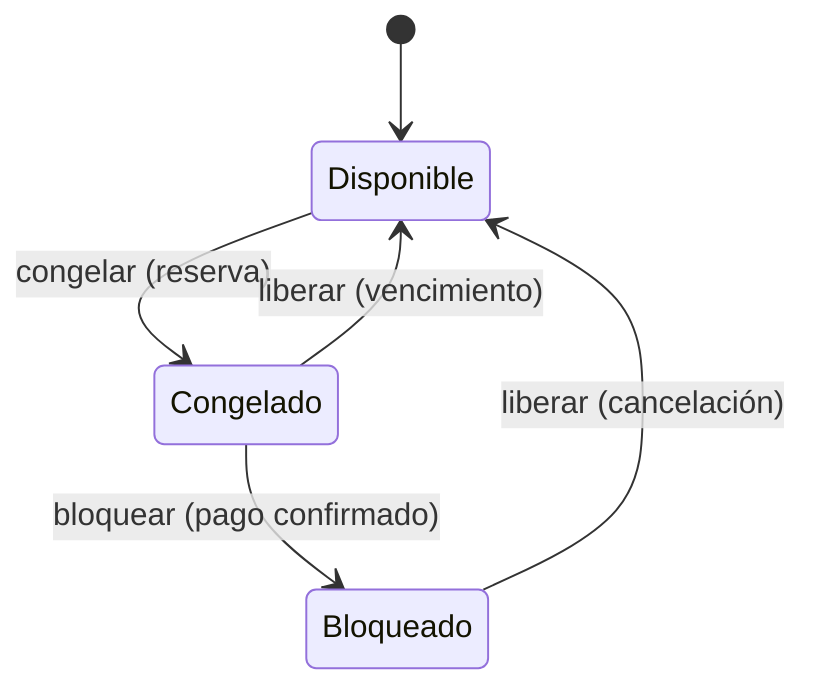

# Máquinas de estado

Fuente única de verdad: `src/domain/state_machine.py` (`TRANSICIONES_SESION`, `TRANSICIONES_BLOQUE`).
Toda combinación (estado, acción) que no aparece aquí lanza `TransicionInvalida` → HTTP 409 sin modificar nada.
La matriz completa 6 estados × 10 acciones (60 casos) se prueba en `test_specifications_y_estados.py::test_matriz_completa_6x10`.

## Sesión (`EstadoSesion`)

## Pago (`EstadoPago`)

## Bloque de agenda (`EstadoBloque`)

## Correspondencia con el paquete de datos del PIA

| Paquete (inscripciones) | AulaPlus |
|---|---|
| PREINSCRITA | Reservada |
| VALIDADA / INSCRITA | Confirmada |
| FINALIZADA | Completada |
| CANCELADA | Cancelada |
