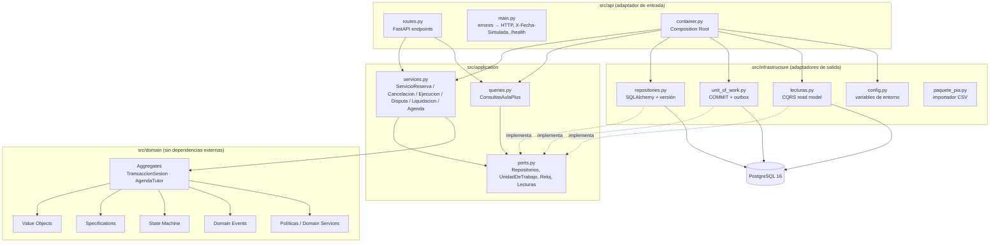
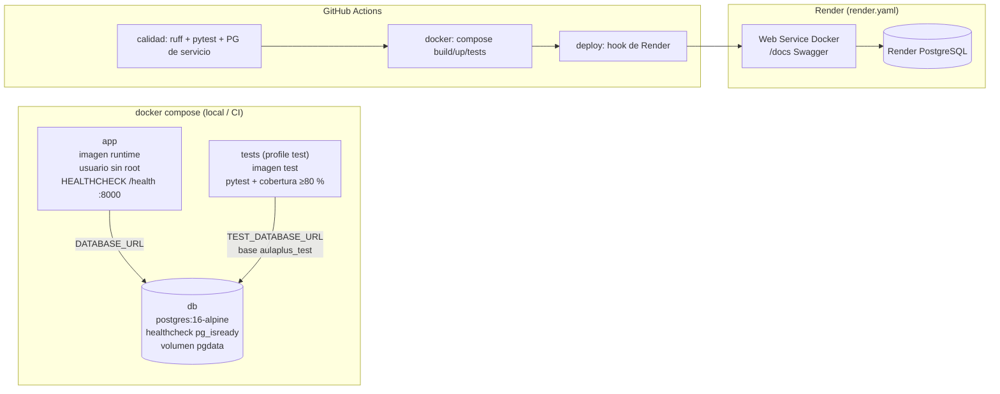

# Arquitectura de componentes (hexagonal) y despliegue

## Capas y dirección de dependencias

`domain` no importa nada de `application`, `infrastructure` ni `api`. `application` depende solo de `domain` y de sus
puertos. Solo `api/container.py` conoce las clases concretas (DIP).

## Despliegue

