# BPMN — Proceso principal de AulaPlus

Proceso: **reserva → pago → sesión → cierre → (disputa) → liquidación**. Refinado del BPMN de la Unidad 2: se
agregaron el registro de pago fallido (H-13), la revisión por evidencia (H-15) y la cancelación del tutor.
Los nombres de actividades coinciden con los métodos de `src/application/services.py`.

- **Swimlanes:** Estudiante · Tutor · Sistema/Plataforma · Soporte · Finanzas
- **Data objects:** Reserva temporal (TransaccionSesion Reservada), Evidencia de asistencia, Disputa, Liquidación (DesgloseFinanciero), Outbox de eventos
- **Eventos temporizados:** 10 min de congelamiento, 10 min de tolerancia No-Show, 48 h de retención, 72 h de mediación

```mermaid
flowchart LR
  subgraph EST[Estudiante]
    A((Inicio: busca tutoría)) --> B[Buscar tutores disponibles<br/>GET /tutores/disponibles]
    B --> C[Seleccionar bloque y reservar<br/>POST /sesiones]
    F[Pagar en la plataforma]
    P1[Abrir disputa]
    Q1[Cancelar sesión]
  end
  subgraph SIS[Sistema / Plataforma]
    D{¿Anticipación ≥2 h, perfil vigente,<br/>tutor no suspendido, bloque libre,<br/>cupo de sede?}
    D -- No --> D1[Rechazar con motivo 422] --> B
    D -- Sí --> E[Congelar horario 10 min<br/>Data: Reserva temporal]
    E --> F
    F --> G{¿Pago confirmado e íntegro<br/>dentro de 10 min?}
    G -- Fallido --> G1[Registrar PagoRechazado] --> F
    G -- Vencido --> G2((Cancelar y liberar horario))
    G -- Sí --> H[Confirmar sesión y bloquear agenda]
    H --> T1[/Espera hasta la hora de la sesión/]
    Q1 --> Q2[Calcular reembolso 100/50/0 %<br/>liberar horario] --> QF((Fin: Cancelada))
    T1 --> I{¿Ambas partes presentes<br/>a los 10 min?}
    I -- No --> I1[Registrar No-Show<br/>tutor ausente: reembolso 100 % + marca] --> IF((Fin: NoShow))
    I -- Sí --> J[Ejecutar sesión]
    J --> K[Registrar evidencia:<br/>conexión / geocerca + confirmación mutua]
    K --> L{¿Evidencia suficiente?}
    L -- Sí --> M[Completar y calcular comisión 20 %<br/>Data: DesgloseFinanciero]
    L -- No --> R[Enviar a revisión]
    M --> N[/Ventana de disputas 48 h/]
    N --> O{¿Disputa abierta?}
  end
  subgraph TUT[Tutor]
    TC[Cancelar sesión] --> TC2[Reembolso 100 % al estudiante<br/>marca si ≤24 h] --> TCF((Fin: Cancelada))
  end
  subgraph SOP[Soporte]
    R --> S[Mediar disputa/revisión<br/>máx. 72 h]
    S --> S1{¿A favor de?}
    S1 -- Tutor --> M
    S1 -- Estudiante --> S2[Reembolso 100 %] --> SF((Fin: Cancelada))
  end
  subgraph FIN[Finanzas]
    U[Liberar pago neto al tutor<br/>POST /liberacion] --> UF((Fin: Pago liberado))
  end
  C --> D
  H -.-> Q1
  H -.-> TC
  O -- Sí --> P1 --> R
  O -- No --> U
```

## Gateways y su regla en el código

| Gateway | Regla | Código |
|---|---|---|
| ¿Se puede reservar? | R-02, R-07, R-10, R-14 | `domain/specifications.py::reserva_permitida` |
| ¿Pago confirmado a tiempo? | R-03, R-04 | `TransaccionSesion.confirmar_pago` / `registrar_pago_fallido` / `expirar_congelamiento` |
| ¿Ambos presentes? | R-09, R-13 | `TransaccionSesion.registrar_no_show` |
| ¿Evidencia suficiente? | R-11 | `EvidenciaAsistencia.es_suficiente`, `completar_con_evidencia` |
| ¿Disputa abierta? / liberación | R-05, R-08, R-15 | `liberacion_permitida`, `abrir_disputa`, `resolver_revision` |

El diagrama original de U2 está en `docs/architecture/diagrams/u3/` y en los PDF de `docs/legacy-u3/`.
